<picture>
  <source media="(prefers-color-scheme: dark)" srcset="assets/dial-dark.svg">
  
</picture>

# Jaden Maciel-Shapiro

Applied AI engineer in St. George, Utah. At Buzz Financial / ExpiTrans I build payment systems that never charge a card twice, and AI agents that only do what they are allowed to. Rust, Go, and Python.

Site: [jadenmacielshapiro.dev](https://jadenmacielshapiro.dev)

## At work

- **Payment service rebuild** (Rust): card sales, voids, and refunds moving off a legacy PHP gateway in seven stages, built so it can never charge a card twice.
- **Internal AI agents** (Rust, OpenAI Agents API): agents in production for risk review, account changes, and partner support, each limited to the tools it is allowed to use.
- **MCP server for the gateway** (PHP): lets agents in editors and internal assistants read and act on gateway data without seeing what they should not.
- **Fulfillment and shipping** (Go): multi-tenant carriers, live rates, labels, returns, and tracking behind merchant storefronts.

The code is private. The case studies are on [the site](https://jadenmacielshapiro.dev/#work) and in the [AI engineering portfolio](https://github.com/jadenmaciel/ai-engineering-portfolio).

## On my own time

- [gauntlet](https://github.com/jadenmaciel/gauntlet): scores every changed function's risk and fails the build when risky code lands. Go, Python, Rust, TypeScript, PHP.
- [symphony-rs](https://github.com/jadenmaciel/symphony-rs): a Rust implementation of the OpenAI Symphony orchestration draft. Linear issues in, isolated workspaces and Codex sessions out.
- [transcript](https://github.com/jadenmaciel/transcript): turns YouTube, TikTok, and Instagram links into text. Captions first, local Whisper when there are none.
- [jstack](https://github.com/jadenmaciel/jstack): a skills pack for Cursor IDE and Cursor Cloud Agents.
- [prompt-improver](https://github.com/jadenmaciel/prompt-improver): an offline macOS app for tightening prompts without an API key.
- [Purely](https://apps.apple.com/us/app/purely-clean-beauty-scanner/id6761502791): an iOS ingredient scanner for cosmetics. SwiftUI, barcode and label capture, on the App Store.

## Contact

Open to applied AI roles and contract work. [LinkedIn](https://www.linkedin.com/in/jaden-maciel/) or [the site](https://jadenmacielshapiro.dev/#contact).
